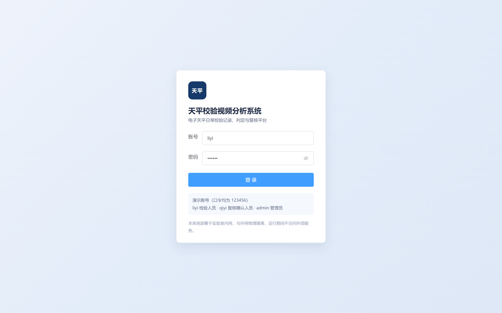
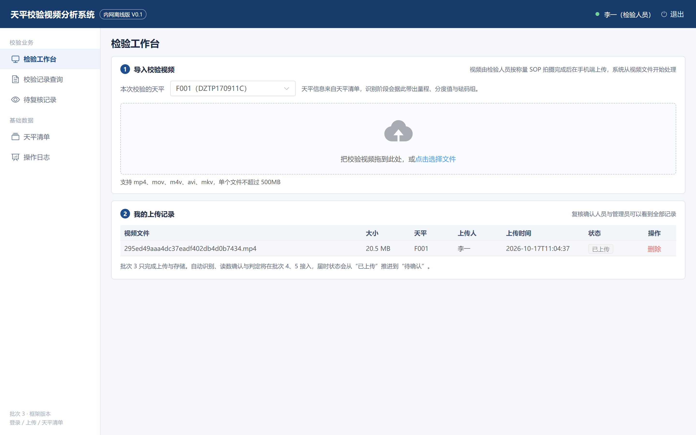
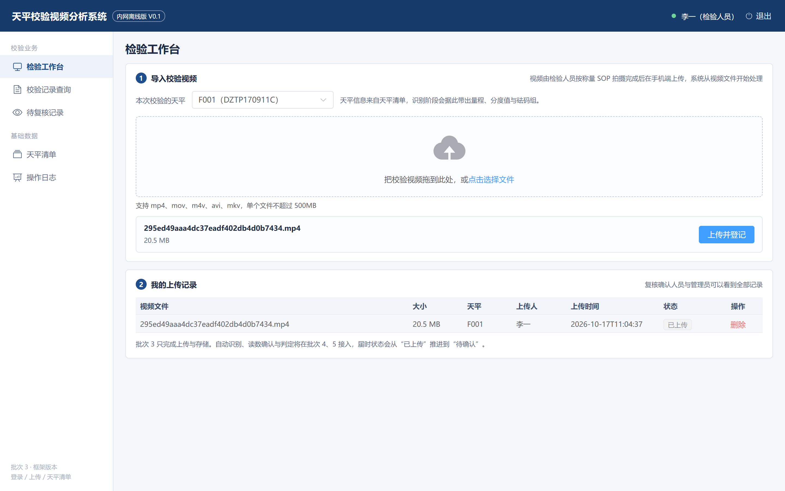
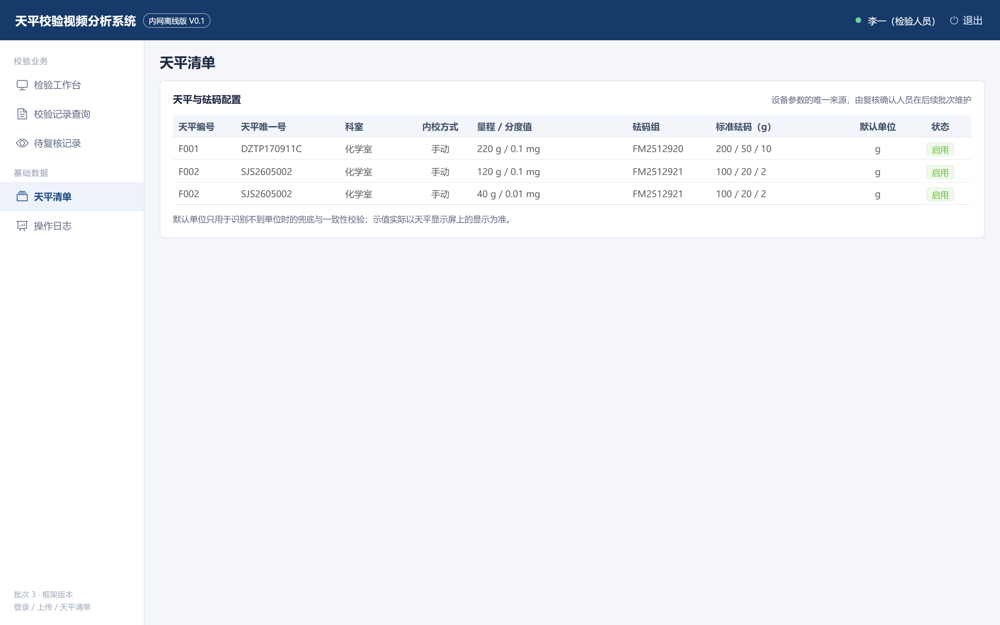

# 天平校验视频分析系统 系统设计说明书

> 文档版本：V1.0（对应批次 2，含批次 3 实施与验证记录）
> 编制日期：2026 年 10 月
> 编写依据：《第8组天平校验视频分析系统项目需求规格说明书》V2.3、甲方需求确认结果

## 一、设计范围与目标

本说明书对应实施计划的第 2、3 批次。第 2 批次确定总体架构、数据库结构、接口契约与界面原型；第 3 批次按设计搭出可运行的框架，做到断网可登录、可上传、可查看天平清单。

设计要解决三个问题。第一，把"手机拍摄并上传"与"电脑端处理"这条链路落成具体的部署结构与接口。第二，把天平清单确定为实现设备参数、限度与砝码配置的唯一来源，避免限度值散落在记录表里。第三，为后续的识别、判定与复核预留数据结构和接口位置，批次 4 至 6 不需要改表。

本说明书不覆盖视频识别算法的实现细节，那部分在第 4 批次单独交付。

## 二、总体架构

### 2.1 分层结构

| 层次 | 组成 | 职责 |
| --- | --- | --- |
| 采集层（系统外） | 手机、支架、人员卡、天平二维码卡、天平显示屏 | 检验人员按称量 SOP 拍摄，在手机上通过上传页提交视频 |
| 接入层 | Vue 3 前端（浏览器，手机与工作站共用） | 登录、上传、记录查看、复核操作；手机端只使用上传页 |
| 业务层 | Spring Boot 3 服务 | 会话与权限、视频登记、天平清单、后续的记录生成与复核状态流转 |
| 分析层（批次 4 接入） | Python 视频分析服务 | 抽帧、二维码识别、读数与单位识别、称量切分，输出结构化 JSON |
| 数据层 | MySQL 8、本地文件系统 | 业务数据、视频文件、操作日志 |

业务层与分析层通过一条 HTTP 接口解耦：业务层把视频路径、天平配置传给分析服务，分析服务返回九次称量的结果数组，业务层负责落库与判定。这样算法可以独立迭代，批次 3 的框架不受影响。

### 2.2 模块划分

| 模块 | 主要类 | 对应需求 | 交付批次 |
| --- | --- | --- | --- |
| 认证与权限 | AuthController、AuthService、AuthInterceptor | FR-20 | 3 |
| 视频接入 | VideoController、VideoService | FR-01、FR-13 | 3 |
| 天平清单 | BalanceController、BalanceService | FR-03、FR-18 | 3 |
| 审计日志 | AuditService、AuditLogMapper | FR-21 | 3 |
| 识别服务 | 待实现（Python） | FR-02 至 FR-07 | 4 |
| 记录与判定 | 表结构已建 | FR-08 至 FR-12 | 5 |
| 复核与查询 | 表结构已建，页面占位 | FR-14 至 FR-17 | 6 |

### 2.3 关键设计取舍

会话采用服务端 Session 而不是 JWT。系统只在内网、单实例部署，Session 足够；退出登录能立即失效，也不需要在前端保存令牌，减少在隔离网络里管理密钥的负担。后续若需要多实例，再引入共享会话存储。

视频存放于文件系统而不是数据库 BLOB。单条视频在 20 至 35 MB，放进数据库会让备份与查询变重；文件系统加数据库元数据是更常见的做法，同时用 SHA-256 保证可追溯。

视频与记录分成两张表。上传只产生 video 记录，识别完成后才生成 calibration，避免"上传即产生校验记录"导致脏数据；记录状态再按草稿、已提交、已复核推进。

## 三、数据库设计

### 3.1 实体关系

用户（sys_user）上传多个视频（video）；天平（balance）有多个量程（balance_range），每个量程引用一个砝码组（weight_set），砝码组包含多个砝码（weight_set_item）。一次校验（calibration）引用一台天平、一个视频和一名检验人员，包含九条称量明细（calibration_measurement），复核人员对记录产生一条复核结论（review）。所有写操作记录到 audit_log。

### 3.2 表结构

| 表名 | 主要字段 | 说明 |
| --- | --- | --- |
| sys_user | id、username、password_hash、display_name、role、card_no、status | 三种角色；卡号用于与视频中的人员卡比对 |
| weight_set | id、set_no、grade、valid_until | 一个编号对应一个砝码盒 |
| weight_set_item | weight_set_id、seq_no、nominal_g | 盒内砝码，按序号排列 |
| balance | id、code、unique_no、department、range_count、internal_calibration_mode、default_unit | 天平清单主表 |
| balance_range | balance_id、seq_no、max_capacity_g、division_mg、weight_set_id | 单量程或双量程 |
| video | id、original_name、stored_name、relative_path、size_bytes、sha256、uploader_id、balance_id、status | 上传的视频与元数据 |
| calibration | id、record_no、balance_id、video_id、inspector_id、calibration_time、external_result、status | 校验记录，批次 5 使用 |
| calibration_measurement | calibration_id、range_seq、weight_seq、measure_seq、nominal_g、lower_g、upper_g、display_value、display_unit、value_g、measured_at、qualified | 九条称量明细 |
| review | calibration_id、reviewer_id、result、comment | 复核结论，一条记录一条 |
| record_template | name、version、content、enabled | 记录表模板 |
| audit_log | user_id、action、target_type、target_id、detail、ip、created_at | 操作留痕 |

### 3.3 关键字段说明

示值拆成三个字段保存：display_value 与 display_unit 是天平实际显示的数值与单位，value_g 是换算后的克值。判定只用 value_g，展示与复核对照用前两个，原始识别文本另存 raw_text。这是"以天平显示为准"这条确认结论在数据结构上的落点。

限度不落库到天平表，而是在记录生成时按 nominal_g 计算 lower_g 与 upper_g 存入称量明细。这样即使以后调整判定比例，历史记录仍保留当时的限度值，便于追溯。

default_unit 是可空的设计性兜底字段，实际单位以识别结果为准；两者不一致时系统提示人工确认，不直接采用默认值。

### 3.4 索引与约束

用户名、天平编号、天平唯一号、砝码组编号、记录编号均为唯一约束。video 按 uploader_id 与 balance_id 建索引，calibration 按 balance_id 加时间建联合索引，便于按天平与日期段查询。称量明细用（记录、量程、砝码序号、称量序号）做唯一约束，防止重复写入。

### 3.5 初始化数据

初始化脚本写入四类数据：四个演示账号（admin、liyi、lier、qiyi，口令均为 123456，BCrypt 散列）、两个砝码组（FM2512920：200/50/10 g；FM2512921：100/20/2 g）、两台天平（F001：DZTP170911C，220 g/0.1 mg；F002：SJS2605002，120 g/0.1 mg 与 40 g/0.01 mg）。数量与配置以需求确认后的天平清单为准。

## 四、接口设计

### 4.1 通用约定

所有接口以 /api 开头，返回统一结构：

```json
{ "code": 0, "message": "ok", "data": {} }
```

code 为 0 表示成功；401 表示未登录；403 表示权限不足；400 表示参数错误；404 表示资源不存在；500 表示服务端错误。登录状态由 HttpOnly 会话 Cookie 维持，前端请求携带 withCredentials。时间统一为 ISO 格式的本地时间（Asia/Shanghai），精确到秒。

### 4.2 接口清单

| 方法 | 路径 | 权限 | 说明 | 批次 |
| --- | --- | --- | --- | --- |
| POST | /api/auth/login | 公开 | 账号密码登录 | 3 |
| POST | /api/auth/logout | 已登录 | 退出并销毁会话 | 3 |
| GET | /api/auth/me | 已登录 | 当前用户信息 | 3 |
| GET | /api/balances | 已登录 | 天平清单（含量程与砝码） | 3 |
| GET | /api/balances/{id} | 已登录 | 单台天平详情 | 3 |
| POST | /api/videos | 检验人员、管理员 | 上传视频并登记 | 3 |
| GET | /api/videos | 已登录 | 视频列表（按角色过滤） | 3 |
| DELETE | /api/videos/{id} | 上传者、管理员 | 删除未进入识别流程的视频 | 3 |
| GET | /api/system/health | 公开 | 健康检查 | 3 |
| POST | /api/analysis/jobs | 内部调用 | 提交识别任务 | 4 |
| GET | /api/analysis/jobs/{id} | 内部调用 | 查询识别结果 | 4 |
| POST | /api/calibrations | 检验人员 | 生成记录草稿 | 5 |
| PUT | /api/calibrations/{id} | 检验人员 | 修改草稿或提交 | 5 |
| POST | /api/calibrations/{id}/review | 复核人员 | 确认或退回 | 6 |
| GET | /api/calibrations | 已登录 | 按天平与日期段查询 | 6 |
| GET | /api/calibrations/export | 复核人员 | 导出 PDF | 6 |

### 4.3 关键接口说明

登录接口接收 username 与 password，成功后把用户写入会话，返回用户编号、姓名、角色与卡号。登录失败返回 401 与"账号或密码错误"，不区分账号不存在还是密码错误。

上传接口使用 multipart/form-data，包含 file 与可选的 balanceId。服务端按扩展名白名单校验格式，限制 500MB，计算 SHA-256 后按 年/月/UUID.扩展名 存储，并把原始文件名、大小、摘要、上传人、天平与状态写入 video 表。返回体的 balanceCode 与 uploadedAt 由数据库回查，保证前端拿到的就是落库结果。

视频列表按角色过滤：检验人员只看到自己上传的视频，复核确认人员与管理员看到全部。删除接口只允许上传者本人或管理员操作，且只允许删除状态为 UPLOADED 的视频，避免把识别中的文件删掉。

### 4.4 错误码与提示

参数校验失败返回具体字段提示，例如"请选择要上传的视频文件""仅支持 mp4、mov、m4v、avi、mkv 格式"。权限不足返回"只能删除自己上传的视频"。文件超过限制返回 413 与"文件超过 500MB 限制"。这些提示直接显示在前端消息条中，不再单独维护错误码字典。

## 五、关键流程设计

### 5.1 登录与权限

前端进入任意页面先调用 /api/auth/me 恢复会话，失败则跳转登录页并带上原路径。后端用拦截器统一校验 /api/**（登录与健康检查除外），未登录直接返回 401，前端拦截器统一跳转登录页。

### 5.2 视频上传流程

检验人员在手机上打开上传页，选择视频并确认天平；前端先做一次扩展名与大小校验，后端再做一次，双重校验避免绕过。上传时显示进度条，成功后刷新列表，状态显示"已上传"。

### 5.3 视频状态机

video.status 的取值为 UPLOADED（已上传）、ANALYZING（识别中）、ANALYZED（已识别，待确认）、FAILED（识别失败）。批次 3 只会产生 UPLOADED；批次 4 的分析服务回调后推进到 ANALYZING 与 ANALYZED。任何非 UPLOADED 状态的视频不可删除。

### 5.4 记录状态机

calibration.status 的取值为 DRAFT、SUBMITTED、REVIEWED。草稿与已提交允许检验人员修改；REVIEWED 之后记录锁定，任何修改需要复核人解锁并留痕。批次 5 实现前三个状态，批次 6 实现复核与锁定。

## 六、界面设计

界面原型见需求规格说明书第三章的八张图，本章只说明本批次实现与后续的对应关系。

| 界面 | 对应原型 | 实现状态 |
| --- | --- | --- |
| 登录页 | 图 3-1 | 已实现 |
| 检验工作台（上传） | 图 3-2 的上传与列表部分 | 已实现（识别结果表待批次 4） |
| 结果确认与提交 | 图 3-3 | 占位 |
| 记录查询与曲线 | 图 3-4 | 占位 |
| 复核工作台 | 图 3-5 | 占位 |
| 天平清单 | 图 3-6 | 已实现（只读，维护功能待批次 7） |
| 导出记录表预览 | 图 3-7 | 待批次 6 |
| 手机上传页 | 图 3-8 | 复用检验工作台的上传组件，手机浏览器可直接访问 |

前端统一使用深蓝顶栏、白色侧栏与浅灰内容区，与原型保持一致。登录页保留演示账号提示，答辩演示时可以直接切换角色。

以下四张图是批次 3 实际运行时的界面截图，不是原型图。









## 七、安全与离线部署

密码使用 BCrypt 散列存储，数据库中不保存明文。会话 Cookie 由服务端管理，前端不保存令牌。上传文件按 UUID 重命名并通过路径规范化校验，防止目录穿越。所有登录、退出、上传、删除都写入 audit_log，包含操作人、对象、时间与 IP。

后端依赖已放在本地 Maven 仓库（D:\develop\m2repo），构建命令加 -o 即可离线执行。前端依赖安装完成后可离线构建，构建产物为纯静态文件，可由内网 Nginx 或 Spring Boot 静态资源目录托管。数据库、后端、前端与后续的 Python 分析服务都部署在同一台内网工作站，运行期不访问外网。

视频不放在 C 盘，也不放在 OneDrive 同步目录里。默认存储路径是 D:/develop/balance-check-data/uploads，所在磁盘剩余 293.3GB，可通过环境变量 APP_UPLOAD_DIR 覆盖。/api/system/health 返回存储路径、总容量、可用容量、使用率和可写状态，运维只看一个接口就能判断是否需要归档。按每天 20 台、单条 30MB 估算约 600MB/天，建议每季度把已复核记录的视频归档到离线介质。

## 八、批次 3 实施与验证记录

### 8.1 环境

JDK 25、MySQL 8.0.46、Node.js 25.9.0、Maven 3.9.16（本地仓库 D:\develop\m2repo）。数据库 balance_check 共建立 11 张表并写入初始化数据。

### 8.2 构建结果

后端执行 -o -DskipTests package 成功，生成 balance-check-0.1.0-SNAPSHOT.jar，28 个源文件编译通过。前端 npm run build 产物输出到 dist。

### 8.3 接口实测

| 用例 | 输入 | 结果 |
| --- | --- | --- |
| 健康检查 | GET /api/system/health | 返回 status=UP |
| 健康检查（含容量） | GET /api/system/health | 返回存储路径、总容量 651.6GB、可用 293.3GB、使用率 55%、可写=true |
| 登录 | liyi / 123456 | 返回李一、INSPECTOR、卡号 RY-001 |
| 当前用户 | GET /api/auth/me | 会话有效，返回同一用户 |
| 天平清单 | GET /api/balances | 返回 F001 与 F002，含 220 g/0.1 mg、120 g/0.1 mg、40 g/0.01 mg 与砝码组 |
| 上传视频 | 21.5 MB 的 mp4，balanceId=1 | 返回视频编号、UUID 文件名、SHA-256 与"已上传"状态 |
| 上传后列表 | GET /api/videos | 返回该视频，天平 F001，上传人李一 |
| 越权删除 | 复核人员删除李一的视频 | 返回 403"只能删除自己上传的视频" |
| 非法格式 | 上传 .txt | 返回 400"仅支持 mp4、mov、m4v、avi、mkv 格式" |
| 错误密码 | liyi / 错误口令 | 返回 HTTP 401 与"账号或密码错误"，前端停留在登录页并提示 |

### 8.4 文件落盘

上传文件保存在 backend/uploads/2026/10/ 下，文件名为 UUID，大小与数据库中 size_bytes 一致，数据库同时保存 SHA-256 摘要，可用于后续去重与追溯。

### 8.5 回归测试

为避免每次改动都靠手工点页面，本批次补了一套可重复执行的冒烟测试。

后端脚本 scripts/smoke-test.ps1 覆盖 16 项：健康检查、未登录拦截、错误口令、登录、会话保持、天平清单与砝码配置、不存在的天平拒绝上传、上传成功、列表一致性、删除、退出与会话失效，当前 16 项全部通过。运行方式：

```powershell
pwsh -File scripts/smoke-test.ps1
```

浏览器端用 Playwright 驱动 Edge 执行 12 项真实操作：错误密码提示且不跳转、登录跳转、选择文件、上传成功提示、列表新增、删除后恢复、天平清单双量程显示、退出登录、未登录访问被拦截、控制台无异常报错，当前 12 项全部通过。

这轮测试发现并修复了一个真实缺陷：登录失败时后端原本返回 HTTP 200 加业务码 401，前端会把它当成会话过期而刷新页面，用户看不到"账号或密码错误"。现在异常处理器按业务码返回对应的 HTTP 状态（401、403、404、413、400），前端也只在非登录请求上跳转登录页。

## 九、后续批次衔接

批次 4 需要新增 Python 分析服务与一个回调接口，把 video.status 从 UPLOADED 推进到 ANALYZING 再推进到 ANALYZED，并把九次称量结果写入 calibration 与 calibration_measurement。批次 5 补限度计算与记录确认界面，批次 6 补复核与 PDF 导出，批次 7 补天平清单维护与模板管理，批次 8 完成测试与离线交付。

表结构与接口路径已按上述顺序预留，后续批次只新增代码，不改动本批次已经验证过的表与接口。

